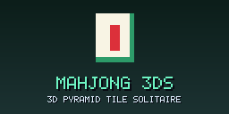
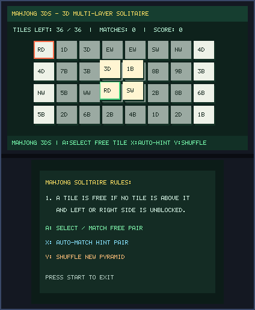
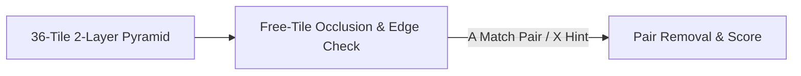

# Mahjong 3DS (`3ds_mahjong`)

<p align="center">
  
  &nbsp;&nbsp;&nbsp;
  
</p>

<p align="center">
  
</p>

> **3D Pyramid Tile Solitaire (`CTR-P-MAHJ`, UniqueId `0x0D3EF`)** — Part of the [**lafiabrew**](https://github.com/orgs/lafiabrew/repositories) Nintendo 3DS Homebrew Suite.

3D multi-layer Mahjong Solitaire (Bamboo, Dots, Winds, Dragon tiles) with upper-layer occlusion, free-edge validation, and auto-hint matcher.

---

## Architecture & Data Flow



---

## Controls & Touch Ergonomics

| Button / Input | Action |
|---|---|
| `D-Pad` | Move cursor across the 36-tile pyramid |
| `A` | Select and match two free tiles with identical faces |
| `X` | Auto-find and match a valid free pair (Hint) |
| `Y` | Shuffle and deal a new pyramid |

---

## Build, Verify & Install

```bash
make test
make 3ds && make verify-3ds
make qr
```
